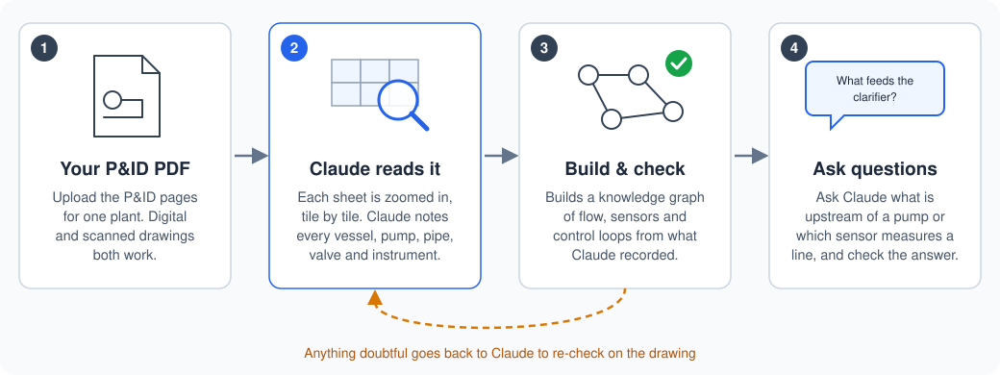

# P&ID to Knowledge Graph

By Scott Duncan. Reach me on [LinkedIn](https://www.linkedin.com/in/s-r-duncan/) or at [scottduncanai.com](https://scottduncanai.com/).

**Turn P&ID drawings into a process knowledge graph that an LLM can reason over.**

`pid-to-kg` is a [Claude skill](https://code.claude.com/docs/en/skills) that reads piping and instrumentation diagrams (P&IDs) and PFDs from PDF and builds a knowledge graph of the process. The PDFs can be digital (exported from CAD) or scanned. The graph captures:

- **Process flow:** what is upstream and downstream of every tank, pump, valve and pipe segment.
- **Measurement:** which instrument measures which variable, and exactly where it sits in the flow.
- **Control:** control loops from sensor through controller to final element, including I/P relays, cascades, interlocks and VFD drives.

The output is meant to be one layer of a chemical-manufacturing **context layer**. An LLM application can query it to answer questions such as "what feeds this clarifier?", "which transmitters sit downstream of P-101?" or "what does FIC-0502 manipulate?" from the drawings themselves.

## Quick start

No programming is needed. You need [Claude Code](https://code.claude.com/docs/en/overview) (the desktop app or the terminal version) and [Python](https://www.python.org/downloads/) 3.10 or newer. Python 3.12 is the best choice: on 3.13 and later the skill still works, but without the text-recognition (OCR) cross-check and automatic page orientation.

**1. Download the skill.** On this page, click the green **Code** button, then **Download ZIP**. Unzip the file.

**2. Install it.** In the unzipped folder, open `skills` and copy the `pid-to-kg` folder into your personal Claude skills folder:

| System | Skills folder |
|---|---|
| Windows | `C:\Users\<your user name>\.claude\skills\` |
| macOS | `/Users/<your user name>/.claude/skills/` |

If the `skills` folder doesn't exist yet, create it. The `.claude` folder is hidden by default: in Windows File Explorer use **View → Show → Hidden items**, and in macOS Finder press **Cmd + Shift + .** to show it.

**3. Add your P&IDs.** Make a new folder for the project and put your P&ID PDF in it. Open that folder in Claude Code: in the desktop app, start a new Code session and choose the folder.

No P&IDs at hand? My [public chemical manufacturing datasets](https://github.com/ScottDuncanAI/public-chemical-manufacturing-datasets#pids) repo lists public P&ID sets from real permitted facilities, with the page numbers where the drawings are. Both digital and scanned sets are included.

**4. Ask Claude to convert them.** For example:

> Convert `haile.pdf` into a knowledge graph. The P&IDs are on pages 47–60.

The skill loads by itself; there is no need to name it. The first time, Claude installs the Python packages it needs, and it asks your permission before running commands. It then reads every sheet in detail, so a large drawing set takes a while. Claude may ask a question along the way, such as which revision to use when a PDF holds two versions of the same drawing. When it is done, it reports what it found and what remains uncertain.

**5. Check the graph by asking questions.** The best test is to ask about things you can verify on the drawings:

> Name all the equipment upstream of the clarifier.
>
> What sensor measures the flow into TK-101, and where exactly is it?
>
> What does FIC-0502 control, and what valve does it move?

The results are saved in `work/<plant name>/kg/` inside your project folder. `summary.md` is a readable overview of the whole plant, and `qa_report.md` lists anything Claude could not confirm.

## How it works



**Claude reads the drawings; Python scripts do everything else.** Recognising symbols and tracing lines needs visual judgement, so that part is Claude's. Preparing pages, building the graph and checking it are routine, so tested scripts do them the same way every time.

### 1. Preparing the pages

A script first looks at every page and works out what kind of drawing it is. Digital and scanned P&IDs need different handling:

| Page type | How to recognise it | What the skill does |
|---|---|---|
| **Digital, searchable text** | Exported from CAD; you can select the text in a PDF viewer | Renders the page straight from the vector data, so lines stay sharp at any zoom. The exact text in the PDF is used to cross-check the tags Claude reads. |
| **Digital, outlined text** | Looks digital, but the text can't be selected: every letter was drawn as shapes. Common in CAD exports. | Renders from the vector data at high resolution. Since there is no text to pull out, OCR (text recognition) reads the tags for the cross-check. |
| **Scanned** | Each page is a picture of a paper drawing | Takes the scanned image at its original resolution, enlarges it up to 2.5×, and boosts the contrast so faded lines and small text stand out. OCR reads the tags for the cross-check. Low-resolution scans are flagged, because small text may be lost. |
| **Scanned with OCR text** | A scan with a searchable text layer added | Handled like a scan. The added text layer is only used as a hint, since it often contains errors. |

Then, for every page:
- **Orientation:** the page is turned so the text is upright, since drawings are often stored sideways in a PDF.
- **Resolution:** chosen from the size of the drawing's text, so the smallest tags stay legible.
- **Tiles:** the sheet is cut into overlapping tiles, and blank tiles (empty margins, border lines) are skipped.

### 2. Claude reads each sheet

- Claude reads the whole sheet first, then every tile up close.
- It records equipment, pipe runs, valves, instruments, signal lines and off-page connectors.
- Each item gets the place on the sheet where it was found and a confidence level. Anything unreadable is marked as such, never guessed.
- Each sheet is saved to its own file before the next one starts, so large drawing sets don't overload Claude.

### 3. Building and checking the knowledge graph

The scripts turn Claude's readings into one connected knowledge graph:
- **Process flow:** each pipe is split into segments between its valves and fittings, and off-page connectors link the sheets, so flow can be traced upstream or downstream across the whole plant.
- **Measurement:** every instrument is attached to the exact pipe segment or vessel it measures.
- **Control:** loops are assembled from the instrument tags (per ISA-5.1) and the signal lines, from sensor to controller to valve or drive.

A QA report then lists anything doubtful: a sensor with no location, an off-page connector with no partner, a tag OCR saw that Claude didn't record. Claude re-checks each one on the drawing and rebuilds until the report is clean.

### 4. Asking questions

- `summary.md` is a readable overview to give an LLM as context.
- `graph.json` holds the full graph for any tool to read.
- `graph.duckdb` is a small database file for precise queries. Nothing needs a server.
- Every item records the sheet it came from, so any answer can be traced back to the drawing.

## Outputs

| File | What it is |
|---|---|
| `summary.md` | A readable overview of the plant: equipment-level flow, equipment, instruments with their locations, control loops and off-page links. This is the file to give an LLM as context. |
| `qa_report.md` | Errors, warnings and notes, each pointing to the part of the drawing to re-check |
| `graph.json` | The complete graph (schema: [`graph.schema.json`](skills/pid-to-kg/references/schema/graph.schema.json)) |
| `graph.duckdb` | The same graph as a [DuckDB](https://duckdb.org) database file, for SQL queries, including recursive upstream and downstream searches |

For larger projects, the graph can also be exported to Neo4j or to GraphML (for yEd, Gephi or NetworkX). Ask Claude to do it.

The node and edge types are described in [`references/ontology.md`](skills/pid-to-kg/references/ontology.md). Equipment and instruments also carry the closest [DEXPI](https://dexpi.org) class, the industry standard for exchanging P&ID data.

## Repository layout

```
skills/pid-to-kg/
  SKILL.md                    workflow Claude follows
  references/                 extraction procedure, ISA-5.1 guide, symbol guide, ontology, JSON schemas
  scripts/                    probe, render, hints, build, query, export, eval, crop
  scripts/pidkg/              library: models, ISA parsing, builder, loops, QA, storage, summary
docs/                         README diagram
tests/                        pytest suite with a synthetic two-sheet plant and synthetic PDFs
```

## Limitations

- **Extraction quality depends on legibility.** Low-resolution scans lose small text. Unreadable items are recorded as such, never guessed.
- **Loops come from ISA tag numbers and drawn signal lines.** Logic that lives only in control narratives or cause-and-effect charts is not on the P&ID and is not captured.
- **Line direction is taken from arrows and equipment logic.** Edges whose direction had to be inferred are marked `flow_direction: inferred`.
- **The DEXPI mapping is informative.** It is not a certified DEXPI export.

## Development

```bash
pip install -e ".[dev]"
pytest
python skills/pid-to-kg/scripts/build_kg.py --write-schemas   # after changing pidkg/models.py
```

## Disclaimer

The graph is machine-extracted from drawings. It must be reviewed by a qualified engineer before it is used for design, operations, management of change, or safety studies such as HAZOP or LOPA.

## License

MIT. See [LICENSE](LICENSE).
