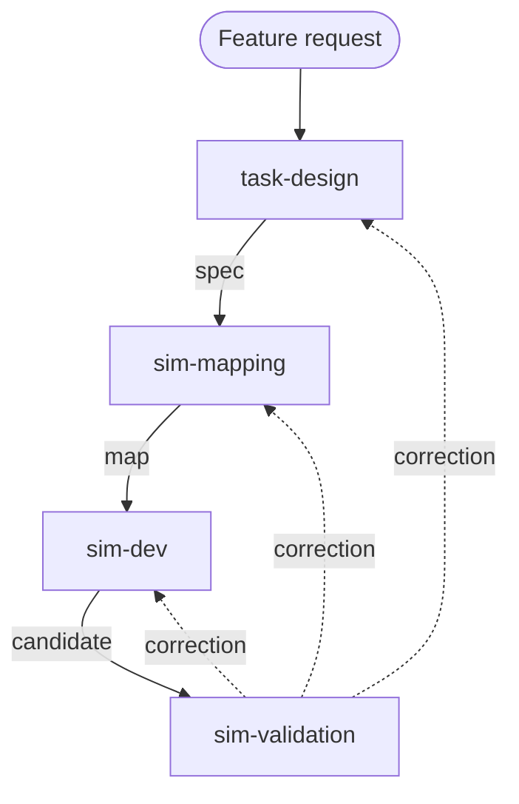

# Agent workflow

Simthesizer turns a serving-feature request into simulator changes through a
harnessed coding agent. The harness is a set of skills in
[`.agents/skills/`](https://github.com/casys-kaist/Simthesizer/tree/main/.agents/skills),
which `.claude/skills` also points to. Claude Code loads them through
`.claude/skills`, and each skill carries `agents/openai.yaml` metadata for Codex.

## Stages

| Stage | Owns | Produces |
|---|---|---|
| `task-design` | Behavior and requirement IDs. Asks the user about open, performance-relevant choices such as mechanism scope, state lifetime, metric boundaries, and permitted approximations. | A behavioral specification |
| `sim-mapping` | The link from each requirement to native state owners, dependency mechanisms, cost paths, and observable checks, with file and symbol evidence. | An implementation map |
| `sim-dev` | The implementation, through registered components and graph nodes, keeping every requirement linked to code or an explicit gap. | A candidate |
| `sim-validation` | Judging the candidate against independent evidence, diagnosing gaps, and deciding to revise, investigate, finish, or report a blocker. | An assessment |

The same task agent owns the whole cycle. Each stage reuses existing task
artifacts and continues authorized work without another approval. Small
changes can keep their spec, map, and assessment in one concise task record.

## Validation modes

- **Trace-guided.** Compatible observations of the target system exist, such
  as request timings or engine state traces. The agent compares the simulator
  against them and diagnoses temporal differences.
- **Reference-guided.** No comparable measurements exist. The agent derives
  criteria from technical sources and builds small diagnostic workloads or
  fixtures that isolate the mechanism.

A passing test supports only the behavior it actually distinguishes. Synthetic
self-comparisons establish tool behavior, not model adequacy.

## Tools

`tools/validate.py` records validation decisions and checks evidence identity
and pending work. Its trace tools compare declared engine observations and
retain gaps, temporal differences, and source provenance. Request-level
analysis stays in `scripts/results.py`.

Source of truth:
[`architectures/agent-workflow.md`](https://github.com/casys-kaist/Simthesizer/blob/main/architectures/agent-workflow.md).
