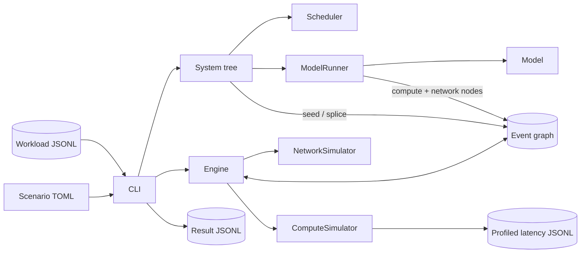

# Simulator overview

The Simthesizer simulator is a deterministic discrete-event simulator for LLM
serving. It is a Rust CLI that reads one scenario config and one workload, and
writes one result file.

The engine owns virtual time and nothing else. Systems, runners, and simulators
own all serving semantics and reach the engine only through graph nodes.

## Design drivers

- **Agent workloads are first class.** Dependencies, think time, and tool-call
  gaps are simulated, not flattened into independent requests.
- **Every cost comes from a mechanism**: a scheduling decision, a cache lookup,
  a profiled kernel, or a contended link. Never a tuned factor or hit rate.
- **Parameters are explicit.** Wrong parameters are the dominant error source,
  so hardware, model, and serving parameters are explicit in the scenario
  config.
- **Adding a component is self-contained**, with no central list to edit.
- **Runs are deterministic.** Equal config and workload give identical results.
- **Accuracy is measured** against real runs, not asserted.

## Components

| Component | Owns | Page |
|---|---|---|
| Engine | The event graph, ordering, and virtual time | [Event engine](event-engine.md) |
| `System` | Request lifecycle and composition into larger topologies | [Serving systems](serving-systems.md) |
| `Scheduler`, `Router` | Batch admission, KV memory, prefix cache; request placement | [Scheduling](scheduling.md) |
| `Model`, `ModelRunner` | Layer plan and memory; one parallelism axis | [Model execution](model-execution.md) |
| `ComputeSimulator`, `NetworkSimulator` | Layer latency; transfer time under contention | [Cost models](cost-models.md) |
| CLI | Config and workload parsing, path resolution, result writing | [Configuration](../reference/configuration.md) |

## Simulation flow

1. The CLI deserializes the scenario into a tree of components, resolves
   relative paths once, and initializes the tree top-down.
2. It validates each workload row and hands it to the root system, which seeds
   that request's DAG into the graph at its arrival time.
3. The engine runs ready nodes in `(time, node ID)` order until the graph
   drains.
4. A logical node calls back into its owner, which may add nodes or rewire the
   running node's outgoing edges. Compute and network nodes ask their simulator
   for a latency.
5. Systems hand over finished requests, and the CLI writes them by request ID.

Any inconsistency aborts the run. A partial result is never written.

## Built-in components

| Trait | `kind`s |
|---|---|
| `System` | `single_instance`, `multi_instance`, `moe_ep_multi_instance`, `pd_disaggregation` |
| `Scheduler` | `chunked_prefill` |
| `Router` | `round_robin`, `moe_load_balancing` |
| `ModelRunner` | `ring` (tensor parallel), `moe_ep` (expert parallel) |
| `Model` | `llama3_1`, `qwen3_moe`, `nemotron_h` |
| `ComputeSimulator` | `table_lookup` |
| `NetworkSimulator` | `flow` |

Source of truth:
[`ARCHITECTURE.md`](https://github.com/casys-kaist/Simthesizer/blob/main/ARCHITECTURE.md).
